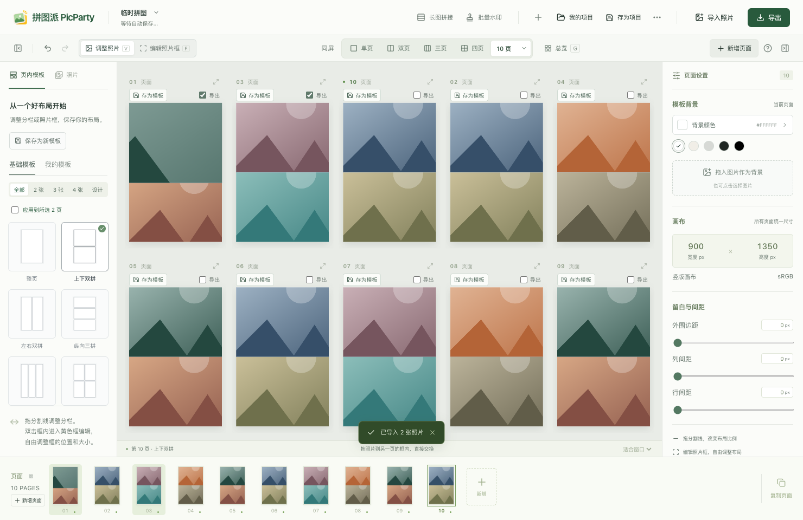

# 拼图派 PicParty · 摄影拼图工作台

拼图派 PicParty 是面向摄影师的 macOS 拼图、自由排版和批量水印应用。`2.1.2-rc.1` 为 Apple Silicon 候选版，原生部署目标为 macOS 13.0，前端目标为 Safari 16。

**作者 / Author：曼陀罗 · © 2026 · [MIT License](LICENSE)**

[GitHub Releases](https://github.com/zhangyj19841123-star/PicParty/releases) · [Mac 安装与首次打开 / Mac installation and first launch](docs/Mac-install.md) · [第三方声明 / Third-party notices](THIRD_PARTY_NOTICES.md)

此 Mac 预览版尚未通过 Apple 公证。首次打开若被 macOS 拦截，核对下载来源和 SHA-256 后，按安装指南从「系统设置 → 隐私与安全性」为 PicParty 单独选择「仍要打开」。

This Mac preview is not notarized. If macOS blocks the first launch, verify the download source and SHA-256, then follow the installation guide to choose **Open Anyway** for PicParty in **System Settings → Privacy & Security**.

## 核心功能 · Highlights

**最多 10 页同屏，照片跨页拖拽互换。** 把照片拖到另一页的空框即可移动，拖到已有照片的框就交换。即使页面使用不同模板，照片的缩放、旋转和调色也会随照片保留。

**See up to 10 collage pages at once.** Drag a photo to an empty frame on another page to move it, or drop it onto a filled frame to swap. Zoom, rotation and color edits follow each photo across layouts.

| 中文 | English |
| --- | --- |
| **在画布上直接编辑。** 单击照片即可缩放，按 ⌘T 旋转，双击可调整照片框。把排好的布局保存为自己的模板。 | **Edit right on the canvas.** Click a photo to resize it, press ⌘T to rotate, or double-click to reshape its frame. Save any layout as a reusable template. |
| **每页独立高清输出。** 可按首张原图推算整组 2:3 竖版尺寸，也可自定尺寸。选页导出 100% 画质 JPG 或无损 PNG。 | **Export each page at full resolution.** Size a set of 2:3 portrait collages from your first photo or choose your own dimensions. Export selected pages as maximum-quality JPGs or lossless PNGs. |
| **长图拼接与批量水印。** 横向或竖向拼接照片。用一张照片定好水印位置，再给整个文件夹批量加图片或文字水印。 | **Stitch long images and batch-watermark photos.** Stack photos vertically or stitch them horizontally. Position a logo or text on a reference photo and apply it to a folder. |



请在 GitHub Releases 中下载 `macOS-arm64` DMG 或 ZIP 和同版的 `SHA256SUMS.txt`。本版修复 Dock 和 Finder 深绿图标的左上角与右下角缺口。

首页「新建拼图」或 ⌘N 直接打开空白画布，可以把照片拖进指定照片框，也可以稍后手动导入。工作台也可恢复上次草稿、通过原生窗口打开 `.collage`，或从最近项目封面继续编辑。点击编辑器左上角品牌可返回工作台。

「存为项目」把临时作品保存到正式项目库。正式项目和临时草稿约 1 秒自动保存。最近项目支持名称搜索、创建和修改时间排序、Finder 定位和从最近记录移除。删除项目需确认，可从「管理项目 → 已删除」恢复。完整 ZIP 可携带拼图素材和编辑状态。旧版资料见 [V2.0 验收报告](docs/V2.0-开发与验收报告.md) 和 [项目与归档说明](docs/v2-storage-and-archive.md)。

## 使用方式

首页和编辑器顶部提供 **长图拼接** 与 **批量水印**，文件菜单也可打开。

**长图拼接**：选择 2～64 张 JPG / PNG，调整顺序，选择竖向或横向；竖向默认以首图宽度统一，横向默认以首图高度统一，也可指定像素和图片间距。初始拼接按照片完整比例排列，生成后单击缩放照片、按 **⌘T / Ctrl+T** 自由变换与旋转、双击进入黄色框编辑、右键置顶或置底，并可撤销、保存 `.collage`、导出 JPG / PNG。长图使用独立的固定尺寸，不采用普通拼图的 2:3 竖版规则；超过 32768 px 边长或约 268 MP 时自动整体等比缩小。「适合窗口」支持完整长图，滚轮与触控板可逐渐缩放查看。开启前先等待当前自动保存完成。这一版先支持图片拼接，文字可通过已有图文图片带入，暂不提供原生文字输入与编辑。

**批量水印**在左侧读取照片文件夹，中间预览当前照片，右侧分别编辑图片和文字。可以同时启用透明 PNG 和文字，直接拖动定位，或选择照片比例、固定像素、指定边距。PNG 支持等比缩放、旋转、透明度和平铺间距。文字使用本机已安装字体，支持多行、换行、字重、字号、颜色、倾斜、间距和对齐。预设可以命名、调用、重命名或删除。

水印面板顶部可删除当前图片或文字层，也可在画布选中图层后按 Delete。工具栏支持撤销、重做，参考照片旁可清除预览引用。文字颜色可输入 HEX 色号，选中一段文字可单独改色。在「描边」「投影」「文字色块」中可分别设置颜色和效果参数。

输入文件夹读取当前层 JPG/PNG，单批最多 5000 张。选择独立的输出文件夹后可批量生成同分辨率成品，默认 JPG 100%，可选 PNG。进度区提供取消和错误列表。预览和输出使用同一个原生排版及合成流程。

1. 新建项目默认「参考首张照片」，生成整组统一的 **2:3 竖版**画布。也可选择「固定尺寸」，使用 4000 × 6000 px 标准尺寸、3:4、4:5、9:16、1:1 或自定义尺寸。
2. 左侧选择**页内模板**，导入 JPG / PNG，或从 Finder、左侧照片库拖到指定照片框。鼠标进入框内会显示目标轮廓，松手即可放入；已有照片则替换。识别整个可见框范围，重叠处以最上层框为目标，框外空白不作为其他框的导入位置。
3. **单击照片即可调整**：绿色四角控制点用于等比放大或缩小照片，直接拖动平移，也支持滚轮 / 触控板捏合。这些操作只改变照片在框内的构图。选中照片后按 **⌘T 或 Ctrl+T** 进入自由变换，在画布上拖角缩放；鼠标移至框外约 **40 px** 的感应区，自动变为弧形双箭头光标，按住拖动即可实时旋转。按 **Enter** 确认、**Esc** 取消本次全部变换。基础调色放在调色面板；「还原」一次恢复初始位置、缩放、角度和调色。
4. **双击照片框内部即可调整框**：黄色轮廓及四角、四边共 **8 个控制点**用于独立改变框的宽高；拖动框内部移动整个框，左键点击框外完成调整。空框同样可双击编辑。框调整与照片缩放分别进行，框编辑时不显示照片的缩放控制点，也不会改变照片构图参数。按 **F** 或点「编辑照片框」也可进入框编辑，按 **V** 回到照片调整，Esc 完成当前调整。框始终保持在页面边界内；铺满页面宽度或高度的框，需要先拖边点收窄或缩短，才有该方向的移动空间。右键空框或已有照片的框，可选「置于最上层」或「置于最下层」。原有 Split 模板的分割线调整仍可使用。
5. 当前布局调整好后，点击**该页标题旁「存为模板」**即可命名保存；单页、同屏多页与总览的每张缩略图都一直显示这个文字按钮。弹窗展示被点击页面的预览、页码与名称，保存的就是这一页，无须先切到单页。保存成功后自动展开左侧「我的模板」，以后可应用到其他页面。顶部固定「新增页面」、底部页条标题及总览中均可新增独立空白页，也可按 **⇧⌘N**；新增页使用当前模板，照片为空。底部可复制或排序页面。顶部**同屏**可显示 1 / 2 / 3 / 4 个独立页面，「更多」可选 **6 / 8 / 10 页**。直接把照片拖到同页或其他页的照片框，已有图时交换、空框时移动，已选中的照片也可直接跨框拖动。所有基础模板与自定义模板之间均可操作，不受照片框数量、槽位名称、留白、错位或重叠布局限制；照片保留拖动前的位置、缩放、旋转和调色，整次移动或交换只占一步撤销。
6. 右侧「模板背景」可更改当前页面的底色；点颜色按钮展开 **RGB / HEX** 选色面板。「系统选色」打开系统颜色面板；桌面应用的「吸管取色」调用 macOS 原生屏幕吸管，点屏幕取色，按 Esc 取消。浏览器预览在支持 EyeDropper 时使用浏览器吸管，否则打开系统选色。可保存常用颜色，下次快速使用。
7. 把图片拖到右侧背景区，或点背景区选择图片，再点「编辑背景」在画布直接拖动位置、拖四角缩放，滚轮 / 触控板捏合也可缩放。背景图片不透明度在右侧调整，100% 完全显示，0% 只显示底色。「还原」恢复背景构图并保留不透明度，「移除」保留底色。背景图片放在照片框下方，不会改变框内照片的构图与调色。
8. 按 **G** 查看项目总览，勾选页面，或按 Command / Shift 多选最多 10 个指定页面，再点「同屏编辑」，只显示选中的页面。总览和底部页条可直接将某个框内的照片拖到另一页的具体照片框，已有图时交换、空框时移动；照片库素材拖入则填入或替换。拖到滚动区域边缘可自动滚动，拖页码标题可调整页面顺序。多页项目导出时选择当前页、所选页或全部页；项目只有一页时，直接导出这一页，无须选择范围或打勾。默认 **JPG、100% 最高画质**，可改选 PNG 无损编码。

画布同时显示多页时，每页页头提供独立的**导出勾选框**；只显示一页时隐藏这个勾选框。总览中的多页项目也提供逐页勾选。普通点击页面只激活该页，不会覆盖已勾选的页面；勾选不会切页、隐藏同屏页面或打断图片调整。多页项目的导出弹窗显示全部页面，可逐页勾选、全选或清空，并显示准确页数。允许取消最后一页；「所选页面」为 0 页时不能导出，需先勾选或改选「全部页面」。项目只有一页时，弹窗省去范围、勾选及全选/清空，直接导出唯一页面，与勾选状态无关；多页项目切换为单页视图后，弹窗仍保留范围选择。新项目默认勾选第一页，后续新增页面不会自动勾选，浏览、构图编辑及撤销也不会自动补勾。开始导出后固定本次项目和页面集合，选择保存位置或同步原图期间切页不会改变此次导出目标。

同屏页数与每页内部照片数量彼此独立。六页通常排列为 3 列 × 2 行，八页为 4 列 × 2 行，十页为 5 列 × 2 行；窄窗口会减少列数，让所有页面完整可见。总览选择 5、7、9 页时，分别使用 6、8、10 页的布局容量，但只显示所选页面，不补入其他页。十页同屏仍然导出十张标准尺寸图片，不会拼成一张屏幕截图。

新项目与新页面的上、右、下、左留白以及行、列间距默认全部为 **0**，可以在右侧「留白与间距」中调整。打开已有作品时保留其保存的间距值。

左侧「基础模板 → 设计」新增 **12 款摄影版式**，双拼、三拼、四拼各 4 款，包括「上满下留白」「错位双片」「主图双细节」「主图三细节」「画廊四联」等。留白属于模板本身的几何构图，会随画布尺寸等比变化；背景颜色和背景图片可以正常显示在留白区域。所有照片框都可双击进入自由编辑，再命名保存为自己的模板。原来的基础模板继续保留，分类中的「2 张 / 3 张 / 4 张」也包含相应的新增版式。

「我的模板」中，每张卡片下方都有**删除**按钮。确认后模板从列表移除，已使用该布局的作品页面与照片不受影响；关闭应用、重开作品或撤销作品编辑，也不会让它再次出现。误删时，展开列表下方的**已删除**，点击对应模板的**恢复**。删除和恢复均保存在本机，且不占用作品撤销历史。内置基础模板没有删除按钮。

「我的模板」可保存任意一页的基础布局及其调整后的照片框，转换成可复用的自由布局。每页的「存为模板」锁定被点击的那一页，打开弹窗不会切换当前编辑页或更改导出勾选；若原项目已切换或该页已删除，会说明原因并禁止保存。保存模板本身不修改作品照片、构图或撤销历史，成功后自动显示左侧「我的模板」。模板按应用保存在本机 localStorage，包含布局几何和框的层级顺序，不包含照片或调色；项目也保存层级，关闭后重开仍保留。使用这个模板新建页面或应用到另一模板的页面时，会沿用保存的层级。自由布局支持 1～64 个框；删除已放照片的框，会将照片移到待排区并保留构图。再次应用同一个模板会清除当前页面的照片框位置覆盖，恢复模板布局，并保留照片构图参数。空框不会遮盖下面的照片。

「参考首张照片」使用原图经过 EXIF 方向修正后的有效像素，以长边推算精确的整数 2:3 竖版：4672 × 7008 的竖图和 7008 × 4672 的横图，都会得到 4672 × 7008 的输出尺寸。首次导入前以 4000 × 6000 预览；尺寸确定后，裁切、缩放、旋转、切换模板和继续导入均不会改变整组输出尺寸。此模式最小 100 × 150 px，总像素不超过 100 MP；固定尺寸与旧项目保持其已设定尺寸。

⌘Z 可撤销构图和页面编辑，一次连续拖动合并为一步；「还原」本身也能撤销。历史最多保留 80 步，并设 64 MiB 内存预算，极大项目可能按预算减少保留步数。选中照片时，页面与间距设置收起，主要操作始终围绕当前照片。

**自由变换**显示照片本身的实际边界，四角等比缩放。鼠标移到框外约 **40 屏幕 px** 的感应区，会自动变为弧形双箭头光标；四角和边缘外侧都可触发，按住拖动即可实时旋转，按住 **Shift** 时按 15° 对齐。画布没有常驻旋转图标、中心标记或内部圆点，旋转围绕照片中心计算，无须拖动原点。框内拖动仍用于移动照片，缩放角点优先响应，旋转感应避开页面标题；照片边界超出窗口时，会尝试在可见框外保留感应范围。画布上的简约控制条可精确输入缩放百分比和角度，也可点确认或取消。确认前可连续移动、缩放、旋转多次，整次自由变换合并为一步撤销；Enter 确认，Esc 恢复进入时的全部构图。切换照片、页面或模式，以及保存、导出、撤销等操作会先确认当前变换。自由变换期间，画布和缩略图均暂停照片交换，确认或取消后恢复。缩放始终保持照片比例，范围为填满照片框时的 1～100 倍；旋转时也会保证照片覆盖框内区域。

独立旋转面板已移除，旋转直接在画布自由变换中完成。**调色面板**仍可拖动标题自由移动，拖到窗口右侧停靠，也可在「设置」中调整透明度或切换停靠、浮动。位置、停靠与透明度会记住，下次打开继续使用，不写入项目，也不占用作品的撤销历史。自由变换时暂时收起调色面板，结束后恢复。

调色面板按顺序提供：**曝光度、色温、色调、对比度、高光、亮度、阴影、自然饱和度、饱和度、黑色**。曝光为 −3～+3 EV，其余为 −100～+100，默认均为 0。它们保存在每次照片放置的构图参数中，应用内调色不改写原图；预览、总览缩略图与原图导出使用同一调色算法。

位置、缩放、旋转和全部 10 项调色跟随这次照片放置：同页或跨页移动、交换均保留；手动调整只改变当前选中的照片实例，同一原图放在其他框中可有不同设置。「还原」以及重新放入照片进行替换，都会恢复初始构图与默认调色，即使替换的是同一张照片；移除照片也会清空该框的构图参数。上述作品编辑均可撤销、重做。

背景颜色、图片路径、构图与不透明度随 `.collage` 项目保存，复制页面会复制背景，之后可独立编辑。背景更换不影响前景照片；同一张原图同时作为背景和框内照片时，两者也各自保存构图参数。选色面板可实时预览，取消恢复原底色，确认合并为一次撤销。常用色板按应用保存，最多 24 个颜色；它不写入作品，也不占用作品撤销历史。背景原图的同路径外部更新同样自动同步，预览与导出均使用更新后的图片。

需要进一步修图时，**右键照片 →「在 Photoshop 中编辑」**。在已安装的 Photoshop 中修改后，保存回同一原图路径，应用会每 2 秒检查文件变化，并在切回窗口时立即检查，自动更新所有使用这张原图的位置。即使外部修改改变了照片像素尺寸，整组输出尺寸和现有位置、缩放、旋转、调色参数仍会保留。同步不新增撤销步骤，应用内撤销继续使用更新后的原图；若另存为新路径，可使用「替换」或「重新链接原图」。

| 操作 | 快捷键 |
| --- | --- |
| 总览 / 返回编辑 | G |
| 单页至四页同屏 | ⌘1 至 ⌘4 |
| 六页 / 八页 / 十页同屏 | ⌘6 / ⌘8 / ⌘0 |
| 新增独立页面 | ⇧⌘N |
| 编辑照片框 / 调整照片 | F / V |
| 照片自由变换 | ⌘T / Ctrl+T |
| 确认 / 取消本次自由变换 | Enter / Esc |
| 旋转按 15° 对齐 | 旋转时按住 Shift |
| 总览快速预览 / 关闭预览 | 空格 |
| 平移画布视图 | 空格 + 拖动 |
| 退出普通照片、照片框或背景调整 | Esc |
| 存为项目或立即保存 / 另存项目文件副本 | ⌘S / ⇧⌘S |
| 撤销 / 重做 | ⌘Z / ⇧⌘Z |
| 导入 / 导出 | ⌘I / ⌘E |

`.collage` 是可读 JSON 项目副本，保存模板、照片与背景路径、页面背景颜色和非破坏式构图参数，不包含原图。V2 默认自动保存到本机项目库，打开旧 `.collage` 后建立独立草稿，避免写回旧文件。素材移动后可通过失联提示定位图片或素材文件夹；长期备份和换电脑请使用完整 ZIP 归档。

## 技术结构

- `src/projects/`：项目抽屉、临时草稿、串行自动保存、视图恢复、素材重连与归档界面。
- `src-tauri/src/library.rs`、`library_commands.rs`、`archive.rs`、`portable_zip.rs`、`reconnect.rs`、`diagnostics.rs`：版本化项目库、原子保存、可恢复删除、完整 ZIP、安全导入、限定目录重连与受控诊断。
- `src/editor/Workspace.tsx`：Konva 画布，多页视口、跨页拖拽、分割线、自由照片框与照片构图。
- `src/editor/photoFrameDrop.ts`：跨框移动与交换，保留拖动前构图并校验手势事务；`photoTransformGesture.ts`、`PhotoTransformBar.tsx`：照片实际边界、等比缩放、连续旋转与自由变换确认；`photoRotationTargets.ts`：框外旋转感应区、缩放角点优先、页面标题避让及超屏回退。
- `src/editor/workspaceLayout.ts`：最多 10 页的屏幕网格、自适应列数及命中坐标；`src/core/workspaceModes.ts` 校验容量与菜单命令。
- `src/platform/dropCoordinates.ts`：原生拖放坐标转换，macOS Retina 使用窗口点坐标；`src/editor/thumbnailDrop.ts`、`photoPointerDrag.ts`、`dragAutoScroll.ts`：缩略图具体照片框命中、跨页照片交换与边缘滚动。
- `src/state/`：项目状态、页面选择与独立视口、事务撤销/重做、版本验证。
- `src/core/templates.ts`：25 个内置模板，保留 13 个结构模板，新增 12 个带留白、主次关系与错落排列的 Free 设计版式。
- `src/core/longImage.ts`、`src/components/LongImageDialog.tsx`：等比长图排版、尺寸预算、照片顺序与方向预览，生成普通可编辑自由布局项目。
- `src/components/WatermarkDialog.tsx`、`src/core/watermarkSettings.ts` 和 `src/state/watermarkPreferences.ts` 管理水印编辑及预设。`src-tauri/src/watermark.rs` 和 `watermark_text.rs` 负责原生预览、批量合成及 CoreText 排版。
- `src/projects/WorkspaceHome.tsx` 和 `projectCovers.ts` 提供工作台、最近项目及封面缓存。项目输出偏好随工作区自动保存。
- `src/brand.ts` 读取 Tauri 产品名称和副标题。`public/brand` 与 `src-tauri/icons` 提供界面标志和安装图标。
- `src/state/templateLibraryStore.ts`：本机命名模板库，以 Free 布局保存当前照片框，支持持久化删除与恢复。
- `src/components/BackgroundControls.tsx`、`ColorPickerDialog.tsx`：右侧背景、RGB / HEX 选色与系统颜色面板；`src-tauri/src/color_sampler.rs` 提供 macOS 原生屏幕吸管，`src/state/colorPaletteStore.ts` 保存常用颜色。
- `crates/collage-core/`：纯 Rust 几何、约束、Cover / Focus、调色与项目验证。
- `crates/collage-wasm/`：把同一几何和调色核心提供给预览。
- `src/images/`：代理图与缩略图缓存、调色预览、原图变化同步、可视区域加载与有限并发。
- `src/platform/`：系统对话框和本地命令适配。
- `src-tauri/src/`：文件、EXIF / ICC、原图渲染、串行批量导出、取消与错误反馈。

页面尺寸和间距以文档像素保存；分割比例与照片 Focus 不依赖屏幕大小。自由模板和页面照片框覆盖使用相对整页的 0～1 归一化矩形，应用到不同像素尺寸时按整页比例适配。macOS 原生拖放使用 AppKit 已提供的窗口点坐标，不重复按 Retina 像素倍率缩小；画布和缩略图都按可见照片框的实际矩形命中。预览使用低分辨率代理，最终 JPG / PNG 重新读取原图。改变模板和应用内调色不会改写原图，也不会把屏幕代理当作高分辨率成品；Photoshop 的同路径保存更新的是外部原图文件。

6 / 8 / 10 页同屏的普通照片使用 512 px 代理预览，选中后提升到 1024 px；单页最多使用 2048 px。这只影响屏幕显示与预览内存，不改变原图导出尺寸和质量。

原生导出按页串行执行，线性光空间进行缩放和透明像素合成，再编码为 sRGB；已占用的文件名自动区分。有限内存预算可能拒绝极大照片，并返回错误。正式性能数据应以目标机器上的真实摄影项目测量为准。

页面合成顺序为底色、背景图片、由底到顶的照片框。`page.frames` 数组保存照片框的层序，模板几何仍按 `slotId` 对应；共享布局返回同一层序，供预览、缩略图命中和原生导出使用。置顶与置底独立占用一步撤销，不改变框位置或照片参数。背景预览与缩略图按线性光合成 PNG 自带透明度和背景不透明度，专用缓存预算为 32 MiB；原生导出读取背景原图并按相同层顺序合成。最终 JPG 和 PNG 均为不透明的整页成品。

外部编辑命令为 `open_in_photoshop(assetId, asset?)`，同步命令为 `refresh_assets(assets: ImageAsset[])`；前端传入当前已授权的素材快照，重新链接后撤销仍会打开、检查当前项目里的原图路径。定时检查、窗口切回检查与导出前同步共用串行队列；结果只有在当前素材 ID、路径和指纹仍与请求快照一致时才应用。原生按素材 ID 与路径分别保存文件检查基线，未变化只检查 metadata，旧快照也可收到此前已发现的同路径更新。

## 开发

需要 Node.js、pnpm、Rust、macOS Command Line Tools、`wasm32-unknown-unknown` Rust target，以及与 `Cargo.lock` 匹配的 `wasm-bindgen-cli`。

```sh
pnpm install
rustup target add wasm32-unknown-unknown
# 安装与 Cargo.lock 中 wasm-bindgen 相同版本的 wasm-bindgen-cli
pnpm desktop:dev
```

本工作目录内已有隔离的 `.tools/cargo`、`.tools/rustup` 和 `.tools/wasm-bindgen` 时，脚本会自动使用它们，不修改系统 Rust 设置。

```sh
pnpm test                         # 前端状态、尺寸策略、模板、照片构图与同步
cargo test -p collage-core         # 几何、调色、约束与项目验证
cargo test -p frame-studio --lib   # 原生图片、外部编辑同步与持久化
pnpm build                        # TypeScript、Rust WASM、前端产物
pnpm desktop:build                # 原生 arm64 .app / .dmg
```

应用产物默认位于 `target/aarch64-apple-darwin/release/bundle/`。`pnpm dev` 提供界面预览，浏览器预览不提供原图导出，也不能在重新加载后恢复原图授权。

拼图和水印功能的 Mac 实测记录见 [2.1.1 验收报告](docs/PicParty-2.1.1-验收.md)。Windows 的后续技术判断见 [平台兼容性评估](docs/platform-compatibility.md)。

## 当前边界

当前支持 JPG / PNG 与 −180°～180° 照片旋转；预览和原图导出使用同一几何规则。翻转、HEIC、RAW、Windows 和 Intel 暂未加入；原图打包使用 V2 完整 ZIP 归档；含翻转参数的项目会被拒绝。旧 `.collage` 文件缺少尺寸策略字段时按固定尺寸读取，不会因首次导入而改变已保存尺寸。

当前采用独立分发、非 App Sandbox 方式，通过用户选择的本地文件工作；前端 asset 协议仅可读取代理图缓存。Mac App Store 的安全书签与沙盒访问授权需要单独适配。

开发包使用本地临时签名。正式对外分发还需要开发者自己的 Developer ID 证书和 Apple 公证，不包含在本机开发签名中。
